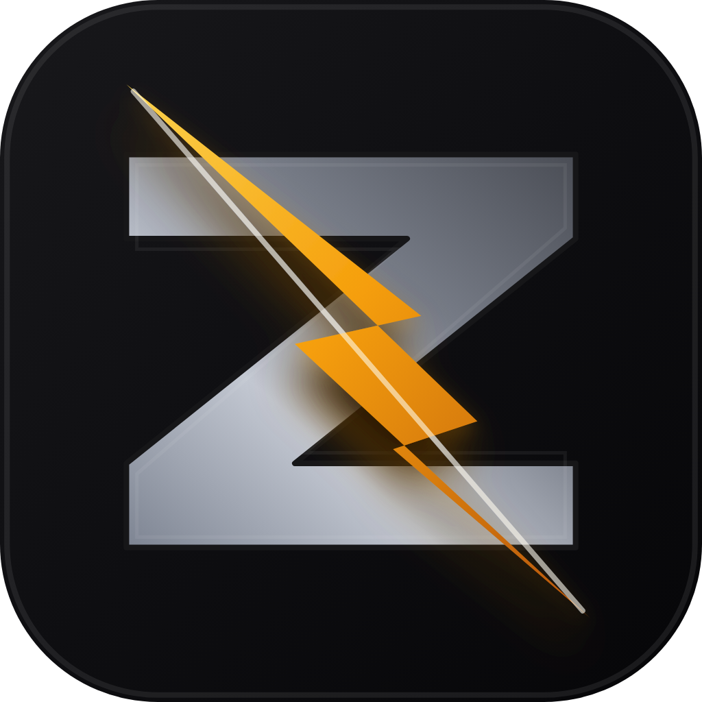

<p align="center">
  
</p>

<h1 align="center">Z-Sync</h1>

<p align="center">
  <b>尼康 Z30 无线传图</b>：手机直连相机的 Wi-Fi，把照片和视频原样传进手机相册。<br>
  <sub>Wireless photo and video transfer from a Nikon Z30 to Android, over PTP/IP.</sub>
</p>

<p align="center">
  Android 12 以上 · MIT 开源 · <a href="https://github.com/tejasChg/z-sync/releases/latest">下载 v0.1.40</a>
</p>

<p align="center">
  <sub>尼康 Z30 · Nikon Z30 · Z30 传图 · SnapBridge 替代 · NEF / RAW · PTP/IP</sub>
</p>

---

## 这是什么

**给尼康 Z30 用的无线传图工具。** 手机连上相机自己开的 Wi-Fi 热点，直接把照片和视频拉进系统相册，中间不经过电脑、不经过服务器。

插读卡器嫌麻烦，官方那条路又慢又爱断，所以直接跟相机说话。

它只做一件事：**把相机里的照片和视频搬进手机相册**，搬的时候什么都不动。

- 文件名不变、画质不变、拍摄信息（EXIF）不变，不改拍摄时间。
- 相册里已经有的自动跳过，不重复存。
- JPEG、RAW（NEF）、MOV、MP4 都支持。
- 照片和相机之间直接传，不经过任何服务器：不用注册、不用登录、不上传云端。

它**不做**这些：修图、滤镜、云端备份、相机参数调节、遥控拍摄、非尼康相机。

### 适用机型

| | |
| --- | --- |
| 相机 | **尼康 Z30**（Nikon Z30）。其它尼康 Wi-Fi 机型用的是同一套协议，理论上一样，但我只有这一台，没验证过 |
| 手机 | 安卓 12 及以上。实测过小米 15（HyperOS / Android 16）和一加 9RT（ColorOS / Android 14） |

## 怎么用

三步：

1. **相机**：按 `MENU` → 设定菜单（图标像扳手）→ 连接至智能设备 → Wi-Fi 连接 → 建立 Wi-Fi 连接，停在这一页。
2. **手机**：打开 Z-Sync，输入相机屏幕上的密码（只输这一次），点「连接相机」。
3. **系统窗口**里选中 `NIKON` 开头的网络，点允许。等一两秒自动进照片页。

之后每次只要把相机的 Wi-Fi 打开、打开应用，它会自己连上。

完整图文手册（带侧边目录，含排查和发日志的步骤）：**[docs/guides/setup.html](docs/guides/setup.html)**

## 下载

最新版本 **v0.1.40**：[Release 页面](https://github.com/tejasChg/z-sync/releases/latest)

| | |
| --- | --- |
| 文件 | `z-sync-0.1.40-40.apk` |
| 大小 | 41 MB |
| 最低系统 | Android 12（API 31） |
| SHA-256 | `5d5fb5368c561d590a4d52535c5def249daf5290ccca6bcca553c73b539ee1ea` |

```bash
shasum -a 256 z-sync-0.1.40-40.apk
```

首次安装要允许「安装未知来源应用」。这是正式签名的 release 包，不可调试。

## 实测到什么程度

| 手机 | 系统 | 结果 |
| --- | --- | --- |
| 小米 15（24129PN74C） | HyperOS / Android 16 | **完整可用**。按下面那条把省电策略设成「无限制」后，切到别的应用十几分钟连接不断，可以后台传图 |
| 一加 9RT（MT2110） | ColorOS / Android 14 | **只能前台用**。切到后台会被系统冻结，连 socket 一起销毁，相机跟着关热点。见 [分析](docs/solution/coloros-background-drop.md) |

相机：尼康 Z30，国行固件。其它尼康 Wi-Fi 机型用的是同一套协议，理论上一样，但我只有这一台，没验证过。

## 功能

**连接**

- 在应用里加入相机热点，密码只输一次，之后自动重连这一台。
- 不从系统「设置 → WLAN」手动连；系统会再问一次是否允许这个应用连该网络，这是安卓的规定。
- 热点没开就一直等扫描；已连上又断了自动重试，最多三次。
- 一分钟连不上进「找不到相机」，给分步排查。连不上和密码错分开提示。
- 只有当前这台热点自己报认证失败才清保存的密码；超时、别的网络都不清。

**浏览**

- 按相机拍摄日分组，日期标题左对齐，没有日期的归到「日期未记录」。
- 「最早 / 最新」切换顺序，「大图 / 列表」切换版式，一屏 4 / 6 / 9 张。
- 格式筛选：全部、JPEG、RAW / NEF、MOV、MP4。筛选不重读相机。
- 缩略图分页加载，每页 10 张。
- 点开看大图，可旋转，显示文件名、大小、光圈、镜头、EXIF。

**同步到相册**

- 原文件名、原 EXIF 写进 `Pictures/Z-Sync`（视频进 `Movies/Z-Sync`），不改内容也不改拍摄时间。
- 相册里已有同一张就跳过。
- 1 MiB 分块流式写盘，内存占用恒定；中断后从已写入位置继续，不整张重下。
- 进度卡显示 `1/4`、已保存几张、还剩几张。

**下载历史**

- 照片页右上角「下载」看这次存了哪些。
- 点开看大图；**只存了 RAW 也能看** —— 应用会从 NEF 里抽出内嵌的 JPEG 预览，不用重连相机。
- 从这里删除只删手机相册，不动相机。

**从相机删除**

- 同一次快门的 JPEG 和 NEF 一起删，相机里标了保护的留下。
- 删除请求攒到空闲心跳时一次提交，避免每删一张机身就切一次回放页。

**后台与日志**

- 连接期间常驻通知，传图时显示「正在保存 1/3 张照片」。
- 连接页底部「导出日志」可把日志分享出来，超过 6 小时自动清理，最多留 5 个文件。

## 它是怎么实现的

不复杂，都是对着协议一步步试出来的。几个要点：

- **连网**：用 Android 的 `WifiNetworkSpecifier` 主动申请连相机热点，网络绑定给应用自己，不动系统默认网络——所以连着相机时手机还能用流量上网。
- **两个 TCP 连接**：连上后跟相机的 `192.168.1.1:15740` 建两条连接，一条发命令（一次一个事务），一条收相机的事件。命令连接读超时 30 秒；事件连接不设读超时，否则读线程会在每次会话 30 秒后死掉。
- **读目录**：`GetStorageIDs` → `GetObjectHandles`（遇到文件夹递归）→ 每张照片再来一次 `GetObjectInfo`，缩略图用 `GetThumb`。所以一次读完整个卡在照片多的时候会慢。
- **传文件**：`GetPartialObject` 每次取 1 MiB，流式写进 `.part` 临时文件，全部写完校验大小再提交到 MediaStore。中断后从已写入的偏移继续。
- **进相册**：用 MediaStore 写入，`RELATIVE_PATH` 定在 `Pictures/Z-Sync` / `Movies/Z-Sync`，文件名和 EXIF 都不动。去重靠「大小 + MIME + 目录」查一遍。
- **保活**：连接期间挂一个前台服务持有进程，每 30 秒发一次 `GET_DEVICE_INFO` 当心跳，让相机那头不把你的会话当超时清掉。
- **看 RAW**：Android 解不了 NEF，所以从 NEF 的 TIFF 结构里把相机内嵌的那张 JPEG 预览按偏移读出来解码，只读一两 MB，不加载整份文件。

结构上分两个模块：

```
shared/     连接状态机、PTP 封包、目录排序。纯 Kotlin，不引用 Android，可以在 Mac 上直接单测。
androidApp/ Compose 界面、Wi-Fi、相机会话、系统相册。
```

连接状态机在 `shared/.../session/LinkMachine.kt`；连热点在 `androidApp/.../link/`；照片和下载在 `androidApp/.../ui/photos/`。

## 手机必须设置的一项

安卓默认认为「相机这个热点没有外网，是不好的网络」，于是把应用切后台就冻结掉。冻结时系统会连带销毁它的 socket，连接断了，相机见没人连着也会关掉 Wi-Fi。

**小米 / 红米（HyperOS、MIUI）：设置 → 应用设置 → 应用管理 → Z-Sync**

1. **省电策略** → **无限制**（关键项）
2. **通知管理** → 允许通知，里面那条「**相机连接**」也要允许

改完验证：连上相机开始传图，切到别的应用待一两分钟再回来，连接还在就对了。

一加 / OPPO / realme（ColorOS）：菜单叫「耗电管理」，设成「允许完全后台行为」也没用，实测切走后几秒还是断。那台机器上只能在前台传完。

## 已知限制

- **ColorOS 上后台传图做不到**，系统冻结应用并销毁 socket，应用层无解。
- **相机热点关了要手动重开**。Z30 没有「保持热点常开」的选项。
- **RAW 看到的是 NEF 内嵌的 JPEG 预览**，不是 RAW 解码，没法放大到 100% 看细节。
- **一次读完整个目录**，照片特别多（几千张）时首次加载慢。默认只加载最近 100 张还没做。
- 速度取决于相机的 Wi-Fi，一张 30 MB 的 RAW 大概二三十秒。
- 界面只有暗色。

## 接下来

- [ ] **分批加载**：默认最近 100 张，可按时间（最近一周 / 半年）或张数选范围。
- [ ] **加载进度**：显示 `已加载 231 / 1000`。
- [ ] **把拍照参数写进机身**：选一套优化校准（Z30 有 11 套）下发到相机，只影响 JPEG。
- [ ] **拍摄地点**：连相机时把位置写进去，或同步 JPEG 时补 GPS（不动画面、不改拍摄时间，NEF 不改字节）。
- [ ] 页面细节打磨。

细节在 [docs/requirements.md](docs/requirements.md)。

## 自己构建

用 IntelliJ 或 Android Studio 打开本目录。

```bash
./gradlew :shared:test :androidApp:testDebugUnitTest --offline
```

打正式包：

```bash
tools/package-release.sh            # 只打包
tools/package-release.sh --install  # 打完顺手装到连着的手机
```

第一次运行会生成 `keystore/z-sync-release.jks` 和 `keystore.properties`（都在 `.gitignore` 里）。**自己发版就要把它备份好**：换一把 key 签更新，用户必须先卸载才能装。

## 文档

全部在 [docs/](docs/README.md)。常看的几份：

- [需求与现状](docs/requirements.md)：范围、还剩什么
- [使用手册](docs/guides/setup.html)：相机和手机怎么设，带目录
- [设计语言](docs/design/design-language.md) + [界面稿](docs/design/index.html)
- [后台断流的完整分析](docs/solution/coloros-background-drop.md)
- [加载进度的方案](docs/solution/loading-progress.md)

## 许可

MIT。见 [LICENSE](LICENSE)。

## 关于这个名字

Z 来自尼康 Z 系列，Sync 是同步。名字直白，是因为它只想解决一件事。

如果你在找这些，就是它：尼康 Z30 传图、Nikon Z30 无线传输、Z30 照片传到安卓手机、不装 SnapBridge 导出照片、尼康 RAW（NEF）导出到手机、PTP/IP 客户端。
