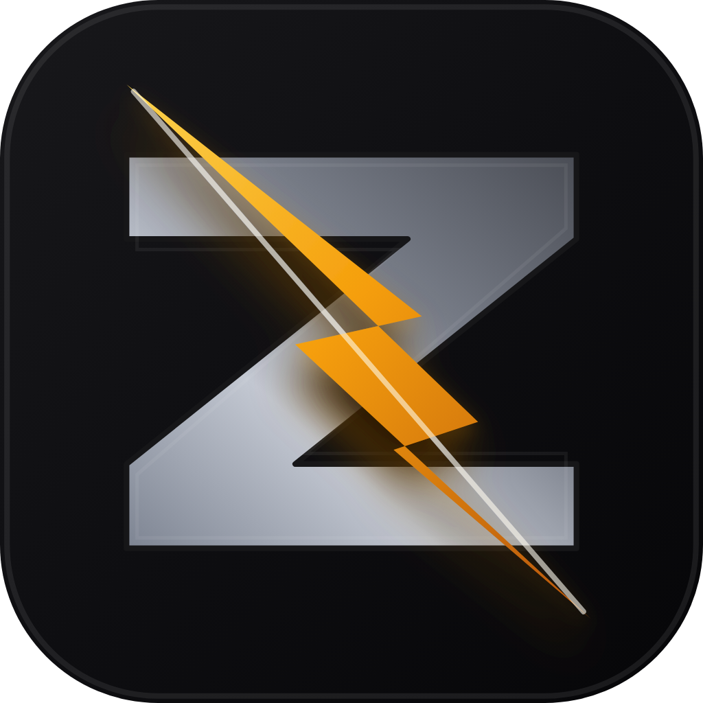

# 图标



一个拉丝钛面的 **Z**，斜着一道琥珀色的闪电（顺手也是 **S**）—— 对应名字里的 Z 和 Sync。

## 文件

| 文件 | 用途 |
| --- | --- |
| `icon.svg` | 母版。1024 的 PNG 和安卓的三层资源都是从这份改的。 |
| `icon-1024.png` | 母版渲染图，README 和各处展示用。 |
| `icon-flat-reference.xml` | 单文件版的矢量，给设计参考用。**应用里实际不用它**，见下。 |

## 应用里用的是什么

安卓的自适应图标必须分层，否则被启动器裁成圆形时会切掉边角。真正生效的是这四个文件：

```
androidApp/src/main/res/mipmap-anydpi-v26/ic_launcher.xml        ← 入口（还有 ic_launcher_round.xml）
androidApp/src/main/res/drawable/ic_launcher_background.xml      ← 底：近黑斜向渐变
androidApp/src/main/res/drawable/ic_launcher_foreground.xml      ← 前：Z + 闪电 + 高光
androidApp/src/main/res/drawable/ic_launcher_monochrome.xml      ← 安卓 13+ 主题图标（单色，系统上色）
```

通知栏那个小图标是 `ic_stat_zsync.xml`，系统会强制单色，所以只用纯白描边。

## 和母版的两处差别

都为了小尺寸能活下来，改的时候别改回去：

1. **前景缩到 0.66**。自适应图标只用中间 72/108 的区域，母版的闪电尖角铺到了画布边上，不缩会被圆形遮罩切掉。
2. **钛面提亮**：`#2D2E33 → #7D8492`，`#4B4E58 → #C3C8D2`。原稿的深钛在近黑底上，到 48dp 就看不见 Z 了，只剩一道橙线。

## 颜色

| 位置 | 色值 |
| --- | --- |
| 底色渐变 | `#18181B` → `#0E0E11` → `#060608` |
| 钛面 | `#7D8492` · `#C3C8D2` · `#767B86` · `#4A4D55` |
| 闪电 | `#FCD34D` → `#F59E0B` → `#B45309` |
| 闪电芯线 | `#FFFFFF` @ 50% |

想调暗一档（更接近原稿的深钛）：把钛面换成 `#4E535E / #8A909E / #4A4E57 / #2C2E34`，48dp 下也还看得见。
