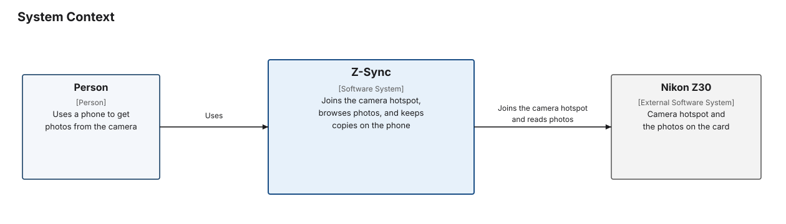
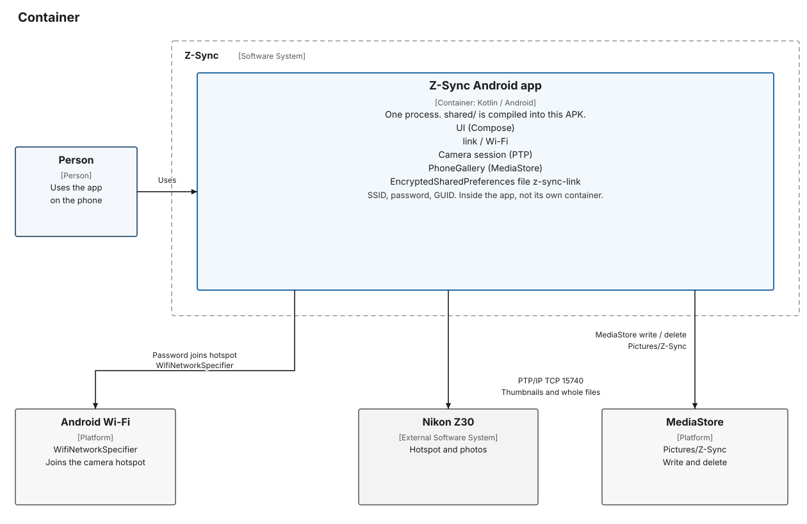
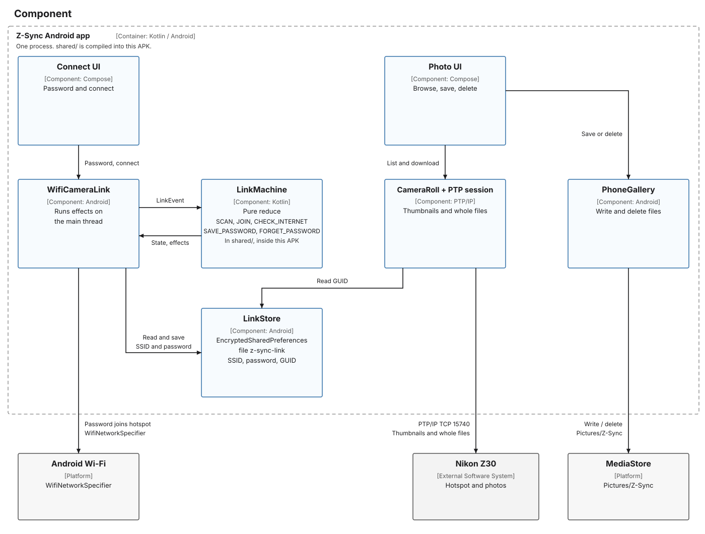

# Z-Sync 技术架构

产品背景、当前范围和还要做的功能在 [需求](../requirements.md)。本文只写实现。

三张图在下面：System Context、Container、Component。不画代码图。实现细节写在后面的策略里。

## 技术选型

| 类别 | 选型 | 版本 | 落点 |
| --- | --- | --- | --- |
| 语言 | Kotlin | 2.0.21 | 两个模块都是 Kotlin，没有 Java 源文件 |
| 运行时 | JVM / Android | JDK 17 | `shared` 是 `org.jetbrains.kotlin.jvm`，还不是 Kotlin Multiplatform |
| 构建 | Gradle、Android Gradle Plugin | AGP 8.7.3 | 模块 `shared`、`androidApp`。`shared` 编进同一个 APK，不是单独的进程 |
| 系统 | Android SDK | minSdk 31，compileSdk / targetSdk 35 | 31 起才能用 `WifiNetworkSpecifier` |
| 界面 | Jetpack Compose、Material3 | Compose BOM 2024.10.01，Activity 1.9.3 | 展现 |
| 状态 | Lifecycle ViewModel 2.8.7 | 连接用 `StateFlow`，照片页用 Compose `mutableStateOf` | |
| 并发 | kotlinx-coroutines | 1.9.0 | 只在 `androidApp` |
| 凭据 | `EncryptedSharedPreferences` | 1.1.0-alpha06，AES256-GCM | 文件 `z-sync-link` |
| 协议 | 自写 PTP/IP | TCP 15740 | 不依赖 gphoto、ptplibrary |
| 相册 | `MediaStore` | 平台 API | 没有 Room |
| 测试 | kotlin.test，JUnit Platform | 随 Kotlin 2.0.21 | 只测 `shared` |

包名 `app.zsync`，当前源码版本 0.1.38（versionCode 38）。

## 架构图

### System Context

使用的人、软件系统 Z-Sync，以及唯一的外部系统 Nikon Z30。人使用 Z-Sync。Z-Sync 加入相机热点并读取照片。

### Container

Z-Sync 里只有一个容器：Android 应用进程。界面（Compose）、热点连接、PTP 会话和 PhoneGallery 都在这个进程里。`shared/` 编进同一个 APK。凭据是应用内的 EncryptedSharedPreferences 文件 `z-sync-link`，不是另一个容器。密码只用于通过 WifiNetworkSpecifier 加入热点。缩略图和整文件走 PTP/IP TCP 15740。写入和删除走 MediaStore 的 `Pictures/Z-Sync`。

### Component

只打开这一个 Android 应用。Connect UI 把密码交给 WifiCameraLink。LinkMachine 是纯 reduce，随 `shared/` 编进这个 APK。密码只走到 Android Wi-Fi 的 WifiNetworkSpecifier。CameraRoll 传图时从 LinkStore 读 GUID，照片字节另走 TCP 15740。PhoneGallery 经 MediaStore 写入或删除 `Pictures/Z-Sync`。

现在连接、网络租约、PTP 会话和照片页的生命周期仍然耦合在 `WifiCameraLink`、`AndroidCameraWifi`、`CameraRoll` 和 `PhotoViewModel`。目标边界、恢复阶梯和传输安全单独写在 [连接可靠性](connection-reliability.md)；那一份是重构目标，不要当成已经落地。

## 已经落地的策略

| 策略 | 类型 | 数据 |
| --- | --- | --- |
| 状态机 | `reduce(LinkState, LinkEvent)`，同步纯函数 | 输入事件。输出新状态，以及 `SCAN`、`JOIN`、`CHECK_INTERNET`、`SAVE_PASSWORD`、`FORGET_PASSWORD`。`WifiCameraLink` 在主线程排队执行。已经连上之后再掉线，重连计数加一，上限 3。现在还没有产品层的 60 秒计时，也没有独立的界面状态 |
| 入网 | `AndroidCameraWifi` | `requestNetwork`。Specifier 里是 SSID、BSSID、`setWpa2Passphrase`。去掉 `NET_CAPABILITY_INTERNET`。不调用 `bindProcessToNetwork`。外网是否还在，读默认网络的 `NET_CAPABILITY_VALIDATED`，放进 `Connected.internetAvailable` |
| 凭据 | `EncryptedLinkStore` | 一个 SSID、一个密码、安装后生成一次的 16 字节 GUID。日志只记密码长度 |
| 命令通道 | `NikonWire`，`CameraRoll` 的 `Mutex` | 两条 TCP。事件连接只发 `InitEventRequest` 并读确认，之后不读。命令连接一次一个事务。`TCP_NODELAY` 开。连接超时 5 秒；命令连接读超时 30 秒，事件连接不设读超时（设了会让事件读线程在每次会话 30 秒后死掉）。主机是 DHCP 网关，没有则 `192.168.1.1`，端口 15740。PTP 失败先重试操作，再在同一个 `Network` 上重建会话，租约不释放 |
| 目录和原图 | `PtpSession` | `GetStorageIDs`、`GetObjectHandles`、`GetObjectInfo`、`GetThumb`。原图是整文件 `GetObject`（0x1009），先收进内存。发起方名称 `Z-Sync` |
| 相册 | `PhoneGallery` | `RELATIVE_PATH=Pictures/Z-Sync`。`DATE_TAKEN` 用拍摄时间。标题 `z-sync-handle:{handle}`。已有则跳过。下载页删除按这个标题删行 |
| 相机内删除 | `planDelete`、`PtpSession.delete` | 按 `burstKey` 计划同一次快门的 JPEG 和 NEF，受保护文件留下。界面上先乐观移除，删除请求排进 `pendingDeletes`，由 30 秒空闲心跳或离开会话时一次 flush（`CameraRoll.deleteAll`），避免每删一张都让机身切一次回放页 |

下载走 `GetPartialObject` 分块（1 MiB），配 `.part` 断点续传，不再整文件读进内存。`OBJECT_ADDED`、`NIKON_GET_PICT_CTRL`、`NIKON_SET_PICT_CTRL` 仍然只是常量。`DELETE_OBJECT` 由延迟删除路径调用。

## 目标用户媒体目录

详细规则和官方来源见 [Z30 用户媒体目录](../features/media-catalog.md)。目录表示 JPEG、NEF、MOV、MP4，只排除 NDF。格式筛选固定为 `全部`、`JPEG`、`RAW / NEF`、`MOV`、`MP4`。

PTP `CaptureDate` 是相机墙上时间，没有时区。当前 `PtpCatalog.parseCaptureMillis` 先构造 `LocalDateTime`，再用 `ZoneOffset.UTC` 强制转 epoch；如果之后按手机时区还原，午夜附近会分到错误日期。目标模型同时保留：

- 原始相机本地日期时间；
- 从原始年月日直接得到的稳定 `LocalDate` 分组键；
- 仅在写系统相册等需要时区的边界上另行解释的时间值。

解析失败时分组键为空，界面归入「日期未记录」。照片和视频共用稳定本地日期键。

目标模型优先按 PTP object format、扩展名回退识别四种用户媒体。流水线是 `完整目录 → 排序 → 格式筛选 → 日期分组 → UI 行`。筛选不清缓存、不重读 PTP；选择按 handle 保存，预览/播放只遍历可见媒体，分页按可见媒体位置触发。

四种格式共用 `TransferQueue` 和 `GetPartialObject` 安全偏移续传，完整视频不得进入内存。JPEG/NEF 写 `MediaStore.Images`，MOV/MP4 写 `MediaStore.Video`。视频优先应用内播放，不支持时使用系统播放器或明确回退。实现与验收拆分见 `MC` 任务。

## 断线时谁释放网络

照片页只在 `LinkPhase.Connected` 时存在。PTP 读取失败走 `readKeepingLease`：先按失败类型重试一次，仍失败就进恢复状态机，**不释放租约**。只有三种情况会释放网络：Android 明确回调 `onLost`、人确认取消、应用结束整个会话。

之前那版是 PTP 一失败就 `release()`，会连带注销维持热点的 `requestNetwork`，于是照片页闪回连接页、相机也跟着关热点。这条已经改掉，别再退回那套。

会话在后台被系统掐断的完整分析见 [后台断流方案](../solution/coloros-background-drop.md)。

## 尚未落地

产品范围在需求文档。这里只留已经定过、代码里还没有的实现。**0.1.38 的事实是：下面这张表里只剩这几行是真的没做。**

| 目标 | 打算的做法 | 现在 |
| --- | --- | --- |
| 新照片自动出现 | 事件连接上的 `ObjectAdded`（0x4002） | 事件连接会读，但读完不解析、不派发。仍靠重新读列表 |
| 地址探测 | DHCP 网关和 `192.168.1.1` 同时探测，谁先完成初始化用谁 | 只用网关，取不到时用 `192.168.1.1` |
| 地点 | BLE 服务 `0000de00-3dd4-4255-8d62-6dc7b9bd5561`。先写 10 字节时间，再写 41 字节 GEO。写不进时，同步 JPEG 只补 GPS 字段 | 没有蓝牙 |
| 风格 | `GetPictCtrlData`（0x90CC）、`SetPictCtrlData`（0x90CD）。抓不到写入操作就不下发。数字在 [拍照风格](../features/picture-styles.md) | 没有这一页 |
| 公共模块 | Kotlin Multiplatform 的 `commonMain`，方便以后加 iOS | `shared` 仍是 JVM 库 |

已经落地的几条，原先记在这张表里的，现在是这样：

- **断点续传**：`GetPartialObject` 1 MiB 分块 + `.part` 文件 + `TransferQueue` 安全偏移，四种格式共用。
- **去重**：查 `MediaStore` 的文件大小 + MIME + 目录，命中就跳过。不用 Room，也不需要句柄表。
- **断线恢复**：`readKeepingLease` 先重试操作再重建会话，租约保留；只有 `onLost` 或人确认取消才释放。
- **两个删除入口**：产品上就是两个独立入口——主照片页删相机，本次下载页删手机相册。不做「双端一起删」。
- **传输前台执行**：连接期间用 `CameraSessionService` 持有进程，通知显示保存进度。

边框的版式在需求文档。实现时用 `ExifInterface` 读拍摄信息，导出 JPEG 质量 98，经 `MediaStore` 另存，原文件不改。代码里没有。

自动同步路线已取消：连接成功不会自动生成「今天未保存的 JPEG」队列。前台服务只延续人已启动的传输。

