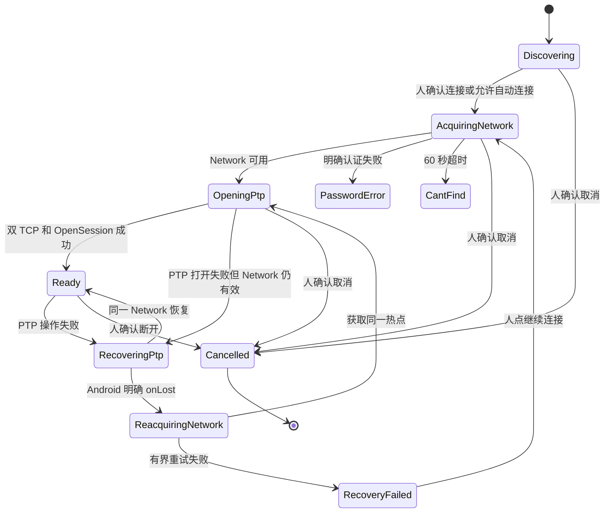

# 连接可靠性

这份文档定义连接和传图稳定性的边界。写它的时候是 0.1.20 的重构目标，**现在这些边界都已经落地（0.1.21 起）**：状态分层、网络租约、同网络恢复 PTP、传输队列与续传都在代码里。已经实现的事实以 [技术架构](architecture.md) 为准，这里留的是「以后改连接时必须遵守的规则」。

人的完整路径在 [使用路径](user-journey.md)，现场症状在 [缺陷](../bugs/bugs.md)。

## 先解决什么

当前最严重的问题不是相机主动发出关热点命令，而是 PTP 读取失败后，应用把它当成 Wi-Fi 已丢失：

1. `PhotoViewModel` 在缩略图、原片或同步遇到部分 `IOException` 时调用 `cameraGone()`。
2. `WifiCameraLink` 把它转成 `NetworkLost`，立即调用 `AndroidCameraWifi.release()`。
3. `release()` 注销 `requestNetwork` 使用的回调。Android 可以马上断开仅由这次请求维持的无网热点。
4. 手机离开热点后，相机看不到客户端，随后可能结束连接或关闭热点。
5. 应用重新加入时回到系统确认，照片页和正在传的队列一起丢失。

这条链把「PTP TCP 断了」「相机网络丢了」「人确认取消」混成同一件事。重构先拆开这三种事件。

## 不能破坏的约束

- Z30 是 Wi-Fi AP，手机必须加入它的无网热点。
- Z-Sync 的相机 TCP 走相机 `Network`，手机默认网络和其它应用仍可以走蜂窝或原来的上网网络。
- `requestNetwork` 从加入成功一直登记到人明确取消、应用明确结束会话，或 Android 调用这条请求的 `onLost`。
- PTP 操作超时、相机关闭 TCP、缩略图失败都不能直接释放 Wi-Fi 网络租约。
- 同一时刻只有一个 PTP 命令事务。事件连接单独读取，不能与命令连接混用。
- 连接成功必须包括 Wi-Fi 网络可用和 PTP `OpenSession` 成功。
- 取消、关闭和恢复都必须幂等。重复事件不能多开回调、套接字或恢复循环。
- 密码只在系统明确报告认证失败时作废。超时、热点没出现和 PTP 失败不清密码。

## 组件边界

### ConnectionCoordinator

连接状态的唯一来源。它接收界面意图、扫描结果、网络回调、PTP 结果和传输结果，决定下一步，但不直接调用 Android 或读写套接字。

它持有四组正交状态：

- `Journey`：第一次连接、第二次自动连接、第二次手动连接。
- `Surface`：首页、正在连接、找不到相机、密码错误、照片页。
- `Link`：未请求、正在获取网络、网络可用、网络已丢失。
- `Session`：未打开、正在打开、可用、正在恢复、恢复失败。

弹窗是独立状态。打开「是否取消连接」不会改变底层连接；只有确认才发出取消意图。

### Discovery

只负责读取扫描结果、按前缀筛选、去重和报告可见热点。它不保存密码，不请求加入，也不根据当前界面偷偷触发加入。

首页和找不到相机页可以一直使用 Discovery。是否加入由 ConnectionCoordinator 根据当前 `Surface` 和人的意图决定。

### CredentialRepository

按完整 SSID 保存加密密码、上次成功时间和最后成功的相机。密码在认证成功前是「待验证」，Wi-Fi 和 PTP 都成功后才标成「可用」。

认证失败只让对应 SSID 的密码失效。扫描超时、系统取消、离开热点和 PTP 错误不清除密码。

### NetworkLease

封装 `WifiNetworkSpecifier`、`ConnectivityManager.requestNetwork`、`NetworkCallback` 和当前 `Network`。

它只有三类结束原因：

1. 人确认取消或断开。
2. 应用明确结束整个相机会话。
3. Android 对当前网络调用 `onLost`，并且没有新的匹配 `Network` 接替。

NetworkLease 不因 PTP 报错结束。重复请求同一个仍有效的 SSID/BSSID 时返回现有租约，不先 `release()` 再申请。

### PtpSessionManager

只在 NetworkLease 提供的 `Network.socketFactory` 上建立命令 TCP 和事件 TCP。它负责 PTP/IP 初始化、`OpenSession`、事务序号、事件读取、保活和同一网络上的会话恢复。

所有预期的断线结果使用统一的可恢复错误，不用裸 `error()` 把「相机关闭连接」变成与其它编程错误相同的 `IllegalStateException`。

### TransferQueue

统一管理缩略图、预览原片和同步任务。优先级是当前预览、当前同步、可见缩略图、预取缩略图；命令通道仍串行执行。

每个任务记录对象句柄、稳定身份、总大小、已安全写入偏移、目标临时文件和结果。队列暂停不会丢任务，恢复后不重下已经完整保存的照片。

## 目标状态

`Ready` 表示 PTP 会话可用，不表示所有照片已经读完。目录、缩略图和原片加载属于照片页与 TransferQueue。

## 恢复阶梯

所有恢复都由一个带 generation token 的循环执行。新一轮连接或人确认取消会让旧 token 失效，防止两条重连循环同时运行。

### 第一级：重试当前操作

- 保持 NetworkLease 和 PTP 会话。
- 对没有产生副作用的读操作重试一次。
- `DeleteObject` 不能盲目重放；先重新读取对象状态，确认对象仍存在才决定。

### 第二级：重开 PTP 会话

- 暂停 TransferQueue，保留当前偏移。
- 关闭命令和事件 TCP，不释放 NetworkLease。
- 等待 1 秒，在同一个 `Network` 上重新初始化双 TCP 和 `OpenSession`。
- 对 `SessionNotOpen` 直接走这一级。
- 依次等待 1、2、4 秒；总恢复时间有上限，且同一时刻只有一轮。

### 第三级：重新获取相机网络

只有 Android 明确调用当前网络的 `onLost` 才进入。

- 标记现有 PTP 会话失效，暂停队列。
- 重新扫描目标 SSID；热点不在时不消耗认证重试次数。
- 用保存的密码重新获取 NetworkLease。
- 新 `Network` 到达后重新打开 PTP 会话，再恢复队列。

### 第四级：交给人恢复

有界重试结束后保留页面和队列摘要，显示「继续连接」和「取消连接」。

- 继续连接开始新的 60 秒尝试。
- 取消连接清理队列、PTP 和 NetworkLease，回到对应连接首页。
- 不把传输超时写成密码错误。

## 传输安全

### 分块读取

原片使用 `GetPartialObject` 分块读取，不再把整张照片作为一个不可恢复的 `GetObject`。

- 第一版从 1 MiB 块开始真机测试。Nikon 旧机型有大请求卡死的公开案例，不预先定成 4 MiB。
- 每块写入临时文件后刷新安全偏移。
- PTP 会话重建后从安全偏移继续。
- 相机报告实际返回字节数，队列按实际值推进，不假定每块总是满的。

### 原子写入

- 下载期间只写应用临时文件。
- 字节数和必要校验通过后，再一次性写入 MediaStore 并标成完成。
- 失败、取消或进程重启后，部分文件不能出现在系统相册里冒充完整照片。
- 同一照片的去重不能只依赖会在重连后变化的对象句柄；后续使用文件名、大小和拍摄时间的组合身份。

### 并发和关闭

- PTP 命令操作、会话关闭和重建经过同一个串行执行器。
- `close()` 不得在另一个线程越过互斥锁关闭正在读取的 socket。
- 人取消下载时先取消队列任务，再安全关闭会话；界面等待关闭结果，不假装已经结束。

## 前后台

- 应用在前台浏览照片时，由进程级 ConnectionCoordinator 持有 NetworkLease。
- 只要人已启动的传输任务仍在运行，就用带常驻通知的前台服务持有 Coordinator、网络租约和队列。
- 没有传输任务、应用进入后台时是否保留连接，由产品策略决定；不能依赖 Activity 是否还在屏幕上。
- 人从最近任务划掉应用时结束会话是允许的。应用不能承诺进程被杀后仍保持相机热点。
- 相机自己的待机定时器仍会关热点，这不是 Android 网络租约能解决的问题。

## 可观测性

日志继续使用 `Z-Sync`，密码只记长度。每条连接和传输日志带同一个会话 ID，并至少包括：

- `journey`、`surface`、`linkState`、`sessionState`
- 目标 SSID 和 BSSID，不含密码
- Network 标识、租约 generation、回调类型
- PTP operation、transaction ID、对象句柄、偏移和块大小
- 恢复级别、次数、原因和耗时
- 队列任务 ID、已安全写入字节和最终结果

必须能从日志区分：

1. Android 先 `onLost`。
2. PTP TCP 先断，但 Network 仍有效。
3. 人确认取消。
4. 进程结束导致租约消失。
5. 相机待机导致热点真正消失。

## 测试边界

纯状态测试覆盖：

- 搜索页永不自行加入。
- 取消确认打开时连接继续；确认后只清理一次且不重新加入。
- PTP 失败先恢复 PTP，不产生 `RELEASE_NETWORK`。
- 只有 `onLost` 进入网络重获。
- 认证失败才清密码。
- 60 秒超时可由注入时钟稳定测试。
- 旧 generation 的回调不能改变新连接。

Android 集成测试用假的 NetworkLease、PtpSessionManager 和 TransferQueue，覆盖回调乱序、重复 `onLost`、取消与恢复竞争。

真机故障注入至少覆盖：

- 加载缩略图时关闭命令 TCP。
- 同步 JPEG 和 NEF 中途关闭命令 TCP，再恢复同一热点。
- 手机仍在热点时只让 PTP 超时。
- 相机热点真正关闭再打开。
- 系统把无网热点切走。
- 传输时应用退到后台，再回前台。
- 人在恢复中确认取消。

验收标准是：PTP 故障不导致应用主动释放仍有效的热点；恢复成功后页面和队列继续；失败时给人可操作出口。

## 外部依据

- [Android NetworkRequest](https://developer.android.com/reference/android/net/NetworkRequest)：未释放的请求会让系统继续维持最佳匹配网络；没有请求维持的网络可以被立即拆掉。
- [Android ConnectivityManager](https://developer.android.com/reference/android/net/ConnectivityManager)：`unregisterNetworkCallback` 可能断开只为该请求建立的网络。
- [Android Network](https://developer.android.com/reference/android/net/Network)：用 `Network.socketFactory` 或 `bindSocket` 把相机 socket 定向到无网 Wi-Fi，不需要绑定整个进程。
- [Wi-Fi Network Request API](https://developer.android.com/develop/connectivity/wifi/wifi-bootstrap)：`WifiNetworkSpecifier` 是连接相机这类对等设备的系统入口。
- [AeroShutter](https://github.com/subhashraveendran/aero-shutter)：Nikon PTP/IP 双 TCP、Wi-Fi 定向 socket、保活、重连和分块导入的现成参考。
- [gPhoto 关于 Nikon 大对象读取卡死的讨论](https://sourceforge.net/p/gphoto/mailman/message/36510757/)：小块 `GetPartialObject` 能避免部分 Nikon 固件在大请求时停住，并支持重建会话后续传。
