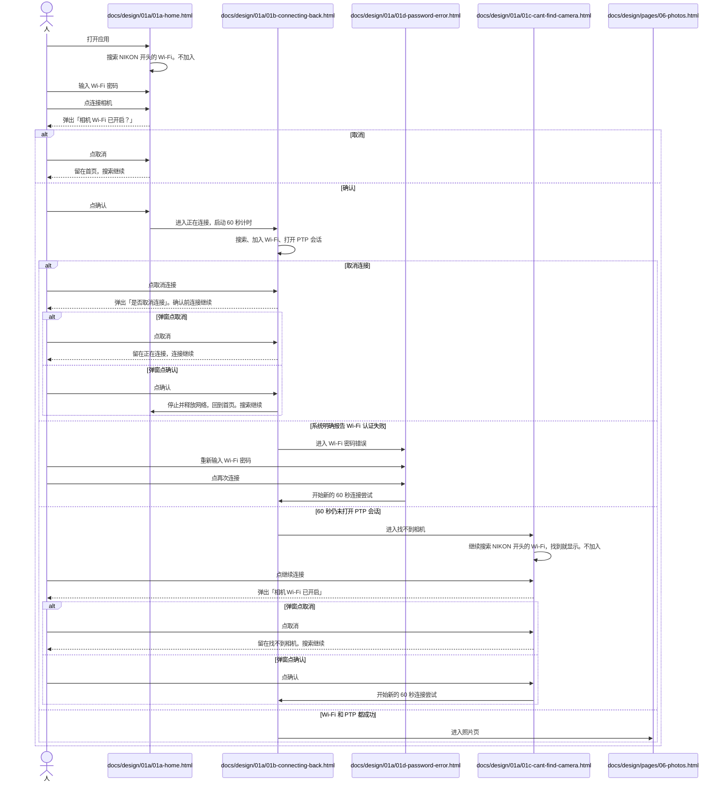
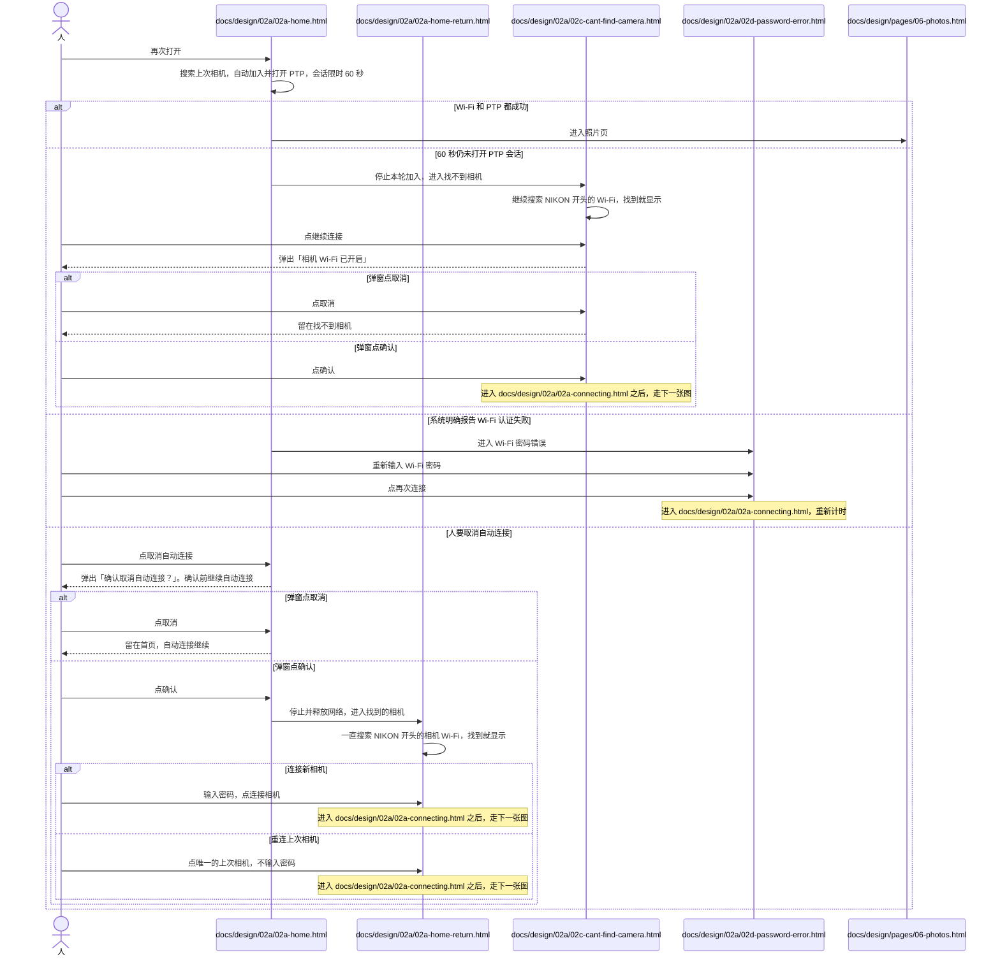
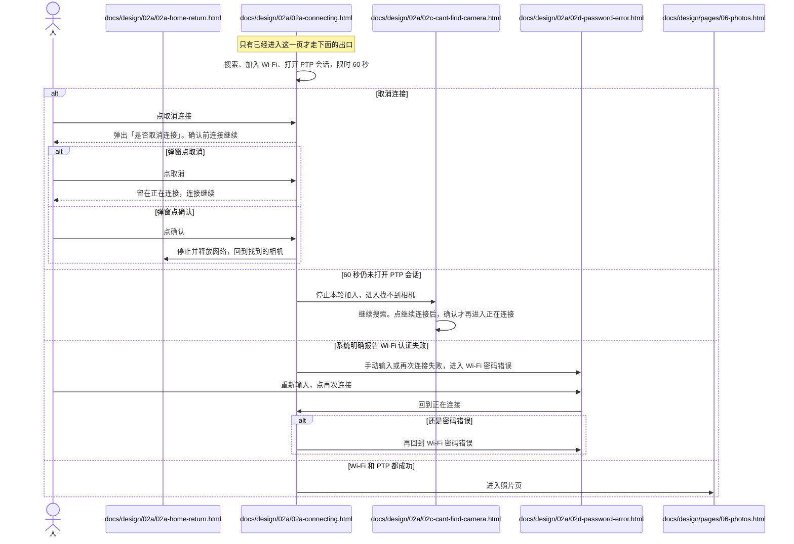
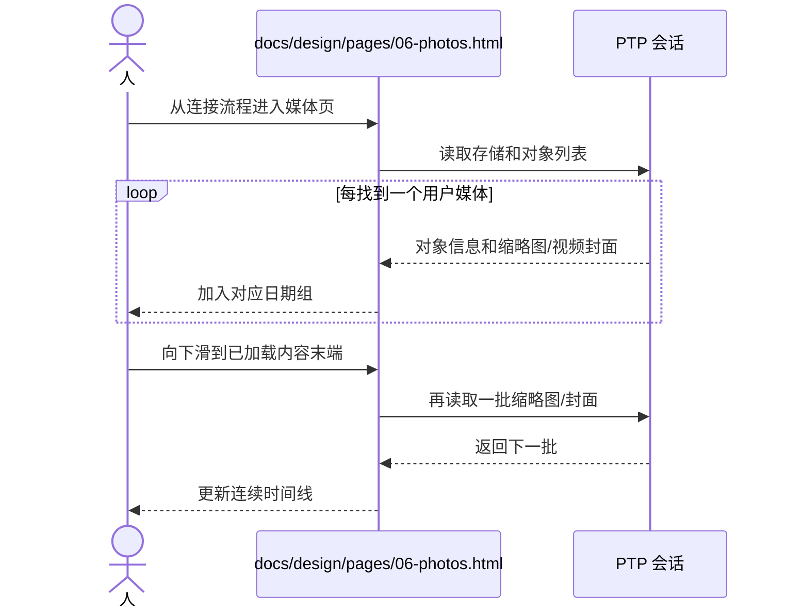
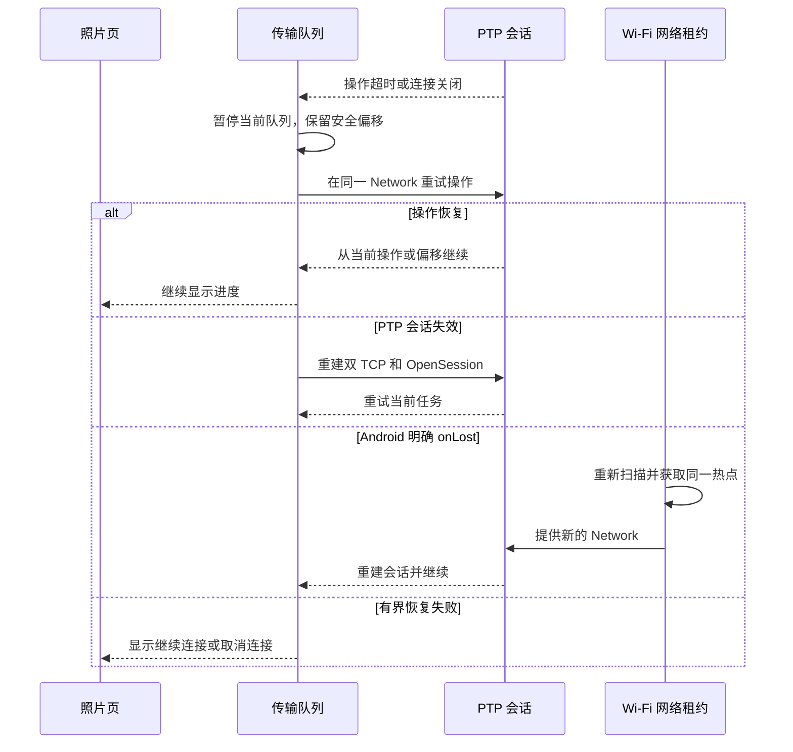

# Z-Sync 使用路径

现在只留第一次连接和第二次连接两条目标流程。页面文件名是改代码时要打开的稿。界面稿改变流程时，这一条必须一起改。

## 共同规则

1. 「搜索」只读取并展示名称以 `NIKON` 开头的热点，不等于加入网络。
2. 只有标成「正在连接」的页面会请求加入热点。每次进入正在连接都启动独立的 60 秒计时；重试时重新计时。
3. 「连接成功」指手机已经取得相机 Wi-Fi 的网络租约，并且 PTP/IP 的命令连接、事件连接和 `OpenSession` 都成功。只拿到 Android `Network` 还不算成功。
4. 照片列表和缩略图在照片页加载。PTP 读取失败先在同一条 Wi-Fi 上恢复 PTP 会话，不因此释放网络，也不立刻跳回连接页。
5. 弹出取消确认框时，后台连接继续。只有人在确认框里点「确认」，才停止连接并释放这次网络请求。取消操作必须幂等，不得再次触发加入。
6. Wi-Fi 密码错误、热点没出现、PTP 会话失败是三种不同结果。只有系统明确报告认证失败，才进入密码错误页。

## 第一次连接

每一步后面是界面稿文件。第 5 步和第 6 步是二选一。第 8 到 10 步、第 11 到 13 步、第 14 到 18 步、第 19 步是正在连接上的几条出口，不是同一次都走完。

1. 打开应用，进入首页 `docs/design/01a/01a-home.html`。
2. 首页搜索名称以 NIKON 开头的 Wi-Fi。首页不加入网络。
3. 人在 `docs/design/01a/01a-home.html` 输入 Wi-Fi 密码。
4. 人点「连接相机」。仍在 `docs/design/01a/01a-home.html`，弹出「相机 Wi-Fi 已开启？」。
5. 人点「取消」。弹窗关掉，留在 `docs/design/01a/01a-home.html`。搜索继续，不加入。
6. 人点「确认」。进入正在连接 `docs/design/01a/01b-connecting-back.html`，60 秒计时从这里开始。
7. 只有 `docs/design/01a/01b-connecting-back.html` 会真正去连 Wi-Fi。这一页继续搜索，找到目标热点后请求加入；拿到网络后，在这条网络上建立 PTP/IP 会话。
8. 人点「取消连接」。仍在 `docs/design/01a/01b-connecting-back.html`，弹出「是否取消连接」。点「确认」之前，这次连接继续。
9. 人在这个弹窗点「取消」。弹窗关掉，留在 `docs/design/01a/01b-connecting-back.html`，连接继续。
10. 人在这个弹窗点「确认」。停止计时、加入和 PTP 建连，释放网络，回到首页 `docs/design/01a/01a-home.html`。搜索继续，加入已经停掉。
11. 系统明确报告 Wi-Fi 认证失败。进入 `docs/design/01a/01d-password-error.html`。
12. 人在 `docs/design/01a/01d-password-error.html` 重新输入 Wi-Fi 密码。
13. 人点「再次连接」。回到正在连接 `docs/design/01a/01b-connecting-back.html`，开始一轮新的 60 秒连接尝试。
14. `docs/design/01a/01b-connecting-back.html` 上 60 秒仍未完成 PTP 会话。停止本轮加入，进入找不到相机 `docs/design/01a/01c-cant-find-camera.html`。
15. `docs/design/01a/01c-cant-find-camera.html` 继续搜索 NIKON 开头的 Wi-Fi，找到就显示。这里不加入。
16. 人点「继续连接」。仍在 `docs/design/01a/01c-cant-find-camera.html`，弹出「相机 Wi-Fi 已开启」。
17. 人在这个弹窗点「取消」。弹窗关掉，留在 `docs/design/01a/01c-cant-find-camera.html`，搜索继续。
18. 人在这个弹窗点「确认」。回到正在连接 `docs/design/01a/01b-connecting-back.html`，开始一轮新的 60 秒连接尝试。
19. Wi-Fi 和 PTP/IP 都连接成功。进入照片页 `docs/design/pages/06-photos.html`。

从正在连接确认取消，回到的是 `docs/design/01a/01a-home.html`。搜索不停，加入已经停掉。

## 第二次连接

每一步后面是界面稿文件。第 3 到第 7 步是首页上的几条出口，只走一条。第 11 步起只在已经进入正在连接之后。

当前只保存上一台成功连接相机的完整 SSID、密码和现有 GUID，不保存多台列表或完整历史。下文的「上次相机」始终是这唯一资料；新相机成功连接后覆盖它。

1. 再次打开应用，进入首页 `docs/design/02a/02a-home.html`。
2. 这一页做两件事。第一，自动搜索相机 Wi-Fi。第二，一旦搜到上次用过的那一台，就在这一页自动加入并建立 PTP/IP 会话，同时启动 60 秒计时。这个自动连接不经过 `docs/design/02a/02a-connecting.html`。
3. Wi-Fi 和 PTP/IP 都连接成功。进入照片页 `docs/design/pages/06-photos.html`。
4. 自动连接 60 秒仍未完成 PTP 会话。停止本轮加入，进入找不到相机 `docs/design/02a/02c-cant-find-camera.html`。
5. 系统明确报告上次那台相机的 Wi-Fi 密码认证失败。进入 `docs/design/02a/02d-password-error.html`。
6. 人在 `docs/design/02a/02a-home.html` 点「取消自动连接」。弹出「确认取消自动连接？」。点「确认」之前，自动连接继续。
7. 人在这个弹窗点「取消」。弹窗关掉，留在 `docs/design/02a/02a-home.html`，自动连接继续。
8. 人在这个弹窗点「确认」。停止自动连接并释放本轮网络，进入 `docs/design/02a/02a-home-return.html`。
9. `docs/design/02a/02a-home-return.html` 一直搜索符合当前 Nikon Z30 规则的热点。找到就显示。这里不加入。
10. 人可以给新相机输入密码并连接；成功后它覆盖上一台资料，不追加历史。
11. 人也可以点唯一的「重新连接上次相机」，用已保存密码进入正在连接；页面不显示多台已保存相机列表。
12. 人在 `docs/design/02a/02a-connecting.html` 点「取消连接」。弹出「是否取消连接」。点「确认」之前，这次连接继续。
13. 人在这个弹窗点「取消」。弹窗关掉，留在 `docs/design/02a/02a-connecting.html`，连接继续。
14. 人在这个弹窗点「确认」。停止计时、加入和 PTP 建连，释放网络，回到 `docs/design/02a/02a-home-return.html`。
15. `docs/design/02a/02a-connecting.html` 上 60 秒还没连上。进入 `docs/design/02a/02c-cant-find-camera.html`。
16. `docs/design/02a/02c-cant-find-camera.html` 继续搜索 NIKON 开头的 Wi-Fi，找到就显示。这里不加入。首页超时和这里超时，进的是同一页。
17. 人点「继续连接」。仍在 `docs/design/02a/02c-cant-find-camera.html`，弹出「相机 Wi-Fi 已开启」。
18. 人在这个弹窗点「取消」。弹窗关掉，留在 `docs/design/02a/02c-cant-find-camera.html`，搜索继续。
19. 人在这个弹窗点「确认」。进入正在连接 `docs/design/02a/02a-connecting.html`，开始一轮新的 60 秒连接尝试。
20. 首页自动连接、手动输入密码或再次连接时，系统明确报告 Wi-Fi 认证失败，都进入 `docs/design/02a/02d-password-error.html`。
21. 人在 `docs/design/02a/02d-password-error.html` 重新输入 Wi-Fi 密码，点「再次连接」。回到 `docs/design/02a/02a-connecting.html`，开始一轮新的 60 秒连接尝试。
22. 这次再次连接如果还是密码错误，再回到 `docs/design/02a/02d-password-error.html`。
23. 人在这次正在连接里确认取消连接。回到 `docs/design/02a/02a-home-return.html`。
24. Wi-Fi 和 PTP/IP 都连接成功。进入照片页 `docs/design/pages/06-photos.html`。

首页上的出口到此为止。只有第 10、11、19、21 步才会进入正在连接。进入之后才有下面这张图。

手动输入密码失败，和首页自动连接因密码被改而失败，进的是同一页 `docs/design/02a/02d-password-error.html`。正在连接满 60 秒，和首页自动连接超时，进的是同一页 `docs/design/02a/02c-cant-find-camera.html`。

## 这些差距后来都补上了

上面四行是 0.1.20 时的记录，作为历史留着。现在的情况：

- 连接页已按第一次、第二次、手动返回拆成 `JourneyPage` 的多个状态，`JourneyScreen` 按状态渲染。
- 确认取消后不再发 `JOIN`，回到首页或返回页就停住。
- 有独立的 60 秒连接计时，超时进「找不到相机」，不把超时当密码错。
- 「只搜索、不加入」已经是独立状态，接着取码显示相机名字，不自动连。

改代码以本文前面的步骤和 [改代码前对照](../process/before-code.md) 点名的稿为准。
- 当前拿到 Wi-Fi `Network` 并检查外网后就进入照片页，PTP 会话在照片页才打开；目标流程要求 PTP 会话打开后才算连接成功。
- PTP 读取异常会被上报为网络丢失并释放网络请求；目标流程要求先在同一网络上恢复 PTP。

## 连接后加载媒体

连接成功后，第一次连接和第二次连接都进入照片页 `docs/design/pages/06-photos.html`，后面的路径相同。

1. 媒体页先显示「正在读取媒体列表」，不等待全部对象读取完才出现内容。
2. 目录接纳 `.JPG`、`.NEF`、`.MOV`、`.MP4`，只排除 `.NDF`。当前实现只接纳 JPEG/NEF，视频是待实现差距。
3. 每读到一个对象，就取照片缩略图或视频封面；没有封面时显示明确占位，并立即加入日期时间线。
4. 日期标题左对齐，同一天照片和视频连续排列；未知日期进入「日期未记录」。没有日期筛选。
5. 每批再取 10 个缩略图/封面；日期标题不算媒体位置，加载按可见媒体数触发。
6. 全部读取完显示 `N / N` 项；没有媒体时显示「相机里没有照片或视频」。
7. PTP 断流时保留已显示媒体，按后面的恢复路径处理。

## 浏览、预览与播放

入口都是 `docs/design/pages/06-photos.html`。日期分组和格式筛选都已经实现。

1. 媒体始终按相机本地拍摄日分段，照片和视频共用左对齐日期标题；未知日期进入「日期未记录」，不提供日期筛选。
2. 人可以在「大图」和「列表」之间切换，并切换「最早 / 最新」。
3. 格式单选固定为 `全部`、`JPEG`、`RAW / NEF`、`MOV`、`MP4`。筛选不重读 PTP、不清缩略图/封面缓存。
4. NEF+JPEG 在全部中显示两个文件，在 JPEG 与 RAW / NEF 中各显示一个；NDF 不显示。
5. JPEG/NEF 进入照片预览；MOV/MP4 支持时应用内播放，不支持时使用系统播放器或明确说明。
6. 预览/播放只遍历当前可见媒体，不经过日期标题或隐藏项目。
7. 照片支持缩放、拖动、旋转和信息卡；关闭后回到原媒体位置。

选择按 handle 保存，格式切换时隐藏项不丢失。日期标题占 Lazy 行，但分页必须按可见媒体位置计算。完整规则见 [Z30 用户媒体目录](../features/media-catalog.md)。

## 从相机删除

从相机删除和从手机相册删除是两条不同路径，界面文案不能都只写「删除」而不说明对象。

1. 人在照片页点「选择」，勾选一张或多张；也可以在全屏预览里点「删除」。
2. 应用弹出确认，说明同一次快门的 JPEG 和 NEF 会一起从相机删除，受保护文件会留下。
3. 人点「取消」，文件和选择状态不变。
4. 人点「删除」，应用通过 PTP `DeleteObject` 逐个删除相机存储卡上的目标文件。
5. 成功删除的文件从照片列表和当前选择中移除；失败或受保护的文件保留，并说明原因。
6. 删除最后一张后仍留在 `docs/design/pages/06-photos.html`，显示「相机里没有照片」。

## 同步到手机相册

1. 人在 `docs/design/pages/06-photos.html` 点「选择」，至少勾一张后才出现「同步到相册」。
2. 人点「同步到相册」，应用结束选择模式，按队列逐张处理。相册里已经存在的照片标成「已跳过」，不重复写入。
3. 照片页只显示当前这一张的进度，包括 `当前/总数`、文件名、百分比、已保存和还剩。
4. 每张完整写入 `Pictures/Z-Sync` 后才标成「已保存」。失败的照片标成「失败」，队列继续处理后面的照片。
5. 全部处理结束后，进度卡收起，照片页显示这次保存、跳过和失败的结果。
6. 下载途中发生断流，队列暂停并走「断流恢复」。恢复成功后从当前文件的安全偏移继续；不得释放仍有效的相机网络，也不得把部分文件当成已保存。

上一版记在这里的两处差距都已补上：同步一开始就离开选择模式；下载走 `GetPartialObject` 分块 + `.part` 断点续传，不再整文件读进内存。

## 本次下载、返回和从手机删除

本次下载入口在照片页右上角，页面稿是 `docs/design/pages/07-download-progress.html`。

1. 没有下载记录时入口写「下载」；本次有成功保存的照片后写「下载 · 本次 N 张」。
2. 人点入口进入 `docs/design/pages/07-download-progress.html`。页面列出本次队列里每张照片的缩略图、文件名和保存结果。
3. 下载仍在进行时，这一页显示当前序号、当前文件、已保存和还剩；下载完成后保留本次结果。
4. 人点一行打开本次下载预览。已保存的照片从系统相册读取原图；未完成的照片变淡并说明状态。
5. 人点「返回」，先从本次下载预览回到本次下载列表；再点「返回」，回到 `docs/design/pages/06-photos.html`。系统返回键走同样层级。
6. 人在本次下载预览点「从相册删除」，应用弹出「从相册删除这张照片？」。
7. 人点「取消」，留在预览。人点「删除」，只删除 `Pictures/Z-Sync` 里的手机副本，并从本次下载记录移除；相机存储卡上的原片不受影响。
8. 如果手机副本没有删掉，记录不能消失，页面要说明失败。

## 断流恢复

传图稳定性是当前最高优先级。PTP 断流和 Android 报告 Wi-Fi 丢失必须分开处理。

1. 缩略图、原片或同步传输超时后，照片页保留现有内容，当前传输进入「正在恢复相机连接」；下载队列暂停。
2. 应用先保留 `NetworkRequest`，在同一个 Android `Network` 上重试当前 PTP 操作。
3. 当前操作仍失败时，关闭两条 PTP TCP 连接，在同一个网络上重新建立命令连接、事件连接和 `OpenSession`，然后重试。
4. 只有 `NetworkCallback.onLost` 明确报告相机网络已经丢失，才重新扫描并获取同一个热点。重新获取成功后重建 PTP 会话。
5. 原片同步按已安全写入的偏移继续；缩略图和目录操作可以从当前批次重试。已经完整写入相册的照片不重复下载。
6. 有界重试仍失败，页面显示可操作的恢复提示。人可以「继续连接」或「取消连接」；取消后才释放网络并回到对应连接首页。
7. 只有人已手动开始且仍未结束的传输在应用退到后台时，后续实现才用前台服务持有会话和队列；暂停后可恢复。它不创建自动同步任务。人主动划掉应用则结束会话，不能承诺继续传输。

## 候选功能路径

下面都尚未落地，不得在界面或需求里写成已经可用。按价值、实现确定性和现有架构的依赖排序。

### 优先做

1. **按日期分开的用户媒体时间线。** 始终按日期分组，不设日期筛选；格式固定为 `全部`、`JPEG`、`RAW / NEF`、`MOV`、`MP4`，只排除 NDF。视频支持原文件传输、播放或回退。
2. **边框导出。** 从手机相册选择一张 JPEG，读取 EXIF，在底部添加统一的机型和拍摄参数后另存，不修改原图。它不依赖相机在线，适合做成连接稳定后的独立功能。

### 可以做，但依赖更多验证

1. **地点。** 优先在拍摄前通过蓝牙把位置交给相机；做不到时，只在同步 JPEG 时补 GPS，NEF 不改字节。
2. **拍照风格。** 路径按 `docs/features/picture-styles.md`：分类浏览配方、查看参数、选择「用这个拍」。只有实机证明 `0x90CC` 能读、`0x90CD` 能写，才显示真正的下发成功；否则只做参数参考。
3. **从相机删除时同步删除手机副本。** 作为现有两条删除路径之上的可选确认，不默认把两端一起删，避免误删。

### 暂不承诺

- 用蓝牙唤醒已经关闭的 Z30 Wi-Fi。公开协议和这台机身的 UUID 还不足，不能把它放进主流程。
- 后台永久保持相机热点。前台服务可以提高传输期间的稳定性，但人划掉应用或相机待机后，Android 应用不能保证热点永远不关。
- 自动同步已取消，不作为候选功能恢复；只保留人手动开始的同步、暂停/恢复、断点续传和传输期间前台执行。
- 多相机、完整连接历史和用户可配置多品牌前缀延期；只有真实需要第二台相机时才按保留的验收资料重评。
